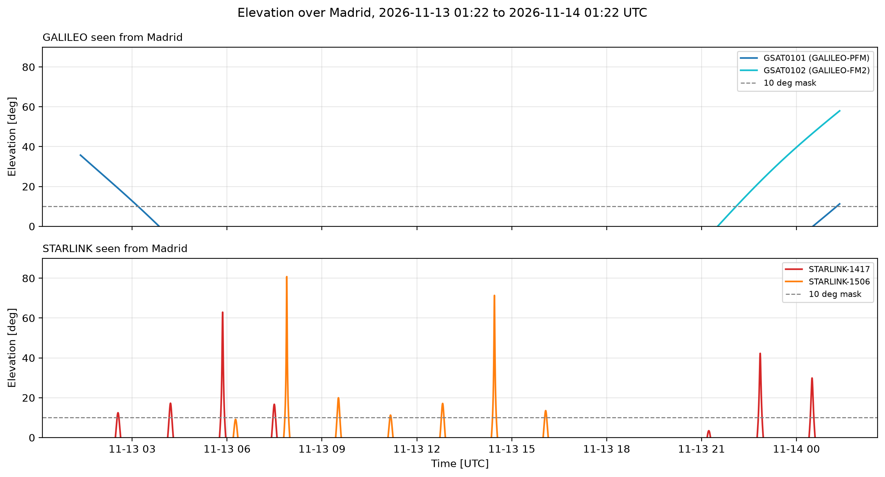
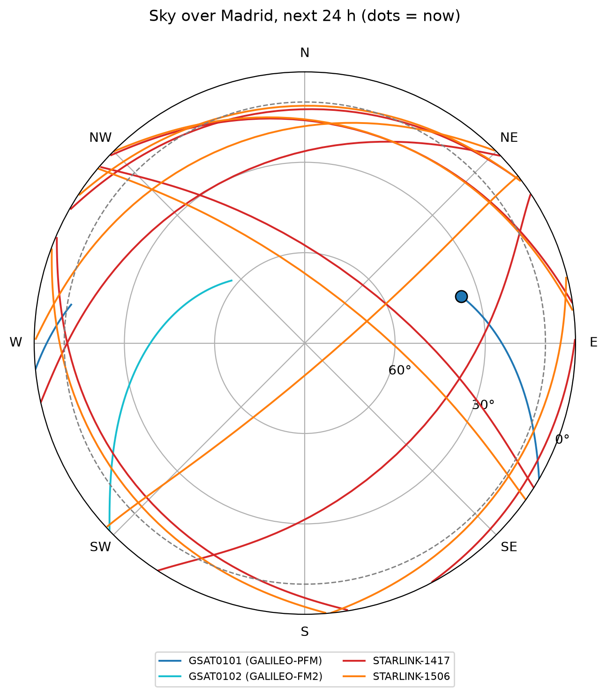

# Galileo vs Starlink · Madrid's sky in real time

How do two very different constellations look from the same place on Earth?
This project downloads today's orbital data from [CelesTrak](https://celestrak.org),
picks two **Galileo** satellites (MEO, ~23 200 km) and two **Starlink** satellites
(LEO, ~480 km), propagates their orbits and compares what an observer in **Madrid**
sees: how often each one rises, how long it stays above the horizon and how high it climbs.

> 🚧 Work in progress. Built step by step on top of my
> [Satellite Orbit Explorer](https://github.com/antonio-palmero/satellite-orbit-explorer)
> (Space Career Week 2026 · GNSS Academy): it started as that course's optional task
> (replace the workshop snapshot with live CelesTrak data) and grew into its own project.

## What it shows



Starlink satellites race across Madrid's sky in **a few minutes**, several times a day,
and most passes stay low. Galileo satellites move slowly and stay up for **hours**:
that is why a GNSS receiver always has several of them in view.



*Skyplot: north up, zenith in the centre, horizon at the edge; dashed circle = 10° mask.*

## Run it

```bash
pip install -r requirements.txt
python galileo_vs_starlink.py
```

Outputs (in `outputs/`): `elevation_madrid.png`, `skyplot_madrid.png` and
`orbits_web.json` / `orbits_web.js` (positions in ECEF and ECI, azimuth/elevation from
Madrid and the pass list, every 30 s, for the web viewer).

The script is split into `# %%` cells, so it also runs cell by cell in VS Code or Jupyter.
Downloaded data goes to `data/` (not versioned); it is fetched again automatically when
it is more than 2 hours old.

## Model

Two-body Keplerian orbits on a spherical Earth. CelesTrak GP records are SGP4 mean
elements, so this is an educational approximation, not a precise orbit prediction.

## Credits

Orbital data from [CelesTrak](https://celestrak.org). Built on the workshop by **GNSS Academy**, Space Career Week 2026 (#SCW26).

**Author:** Antonio Rodríguez-Palmero Tajuelo, Telecommunications Engineering student at ETSIT-UPM · [LinkedIn](https://www.linkedin.com/in/antonio-rodr%C3%ADguez-palmero-tajuelo-6416802aa/)
